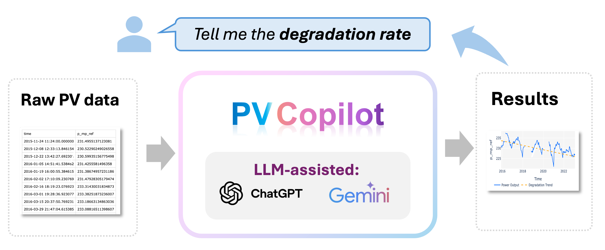
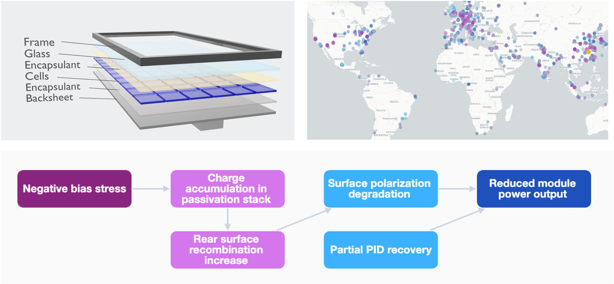
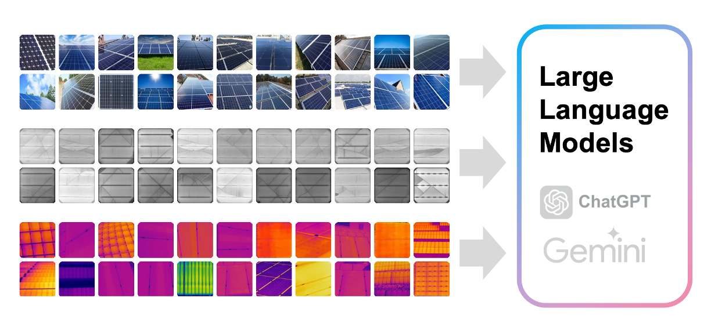
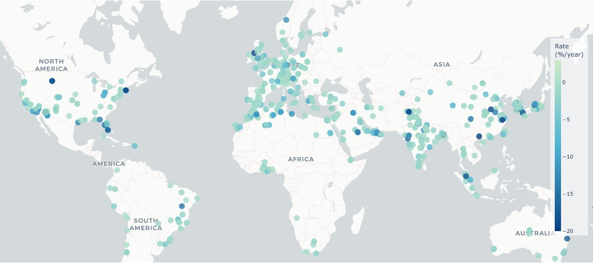
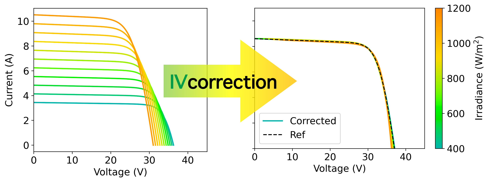
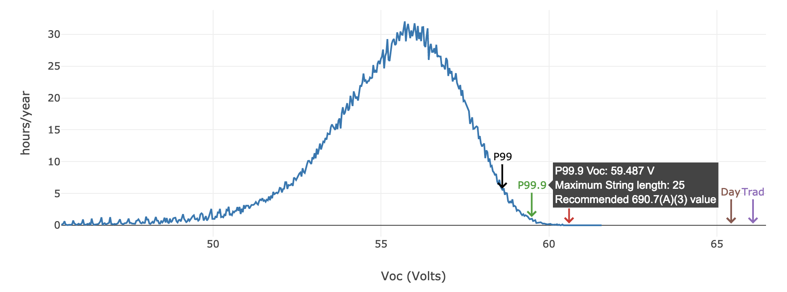
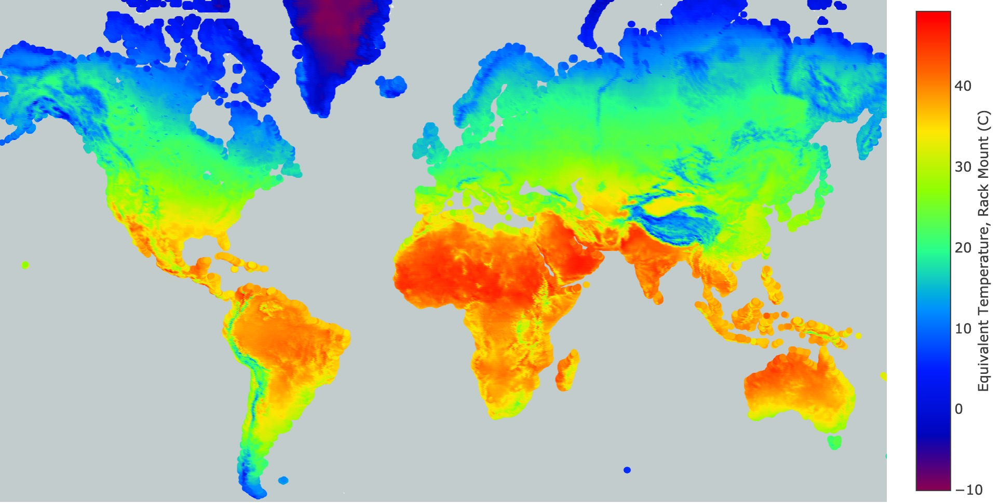

# PVTOOLS


PVTools is a collection of **open-source web applications and Python tools for photovoltaic (PV) reliability and system analysis**.

The tools are developed by the **[LBL HackingMaterials Group](https://hackingmaterials.lbl.gov/)** at **Lawrence Berkeley National Laboratory** as part of the **[DuraMAT Consortium](https://www.duramat.org/)**.

PVTools provides interactive tools and datasets to support **PV system design, degradation analysis, and reliability research**.

**Live site: [pvtools.lbl.gov](https://pvtools.lbl.gov)**

---

# Table of Contents

- [Cite our work](#cite-our-work)
- [Applications](#applications)
- [Repository Structure](#repository-structure)
- [Running Locally](#running-locally)
- [Deployment](#deployment)
- [Logging and Privacy](#logging-and-privacy)
- [Contributors](#contributors)
- [Copyright](#copyright)

---

# Cite our work
If you use **PVTOOLS** in your research, please cite:

B. Li, T. Karin, X. Chen, and A. Jain, pvtools: Toolkit for Photovoltaic Data Analysis and Modeling, Zenodo, Jun. 2022. DOI: https://doi.org/10.5281/zenodo.15654456

If you use a specific tool, please also cite the related paper:

**PV-Copilot**
- B. Li and A. Jain, "PV Copilot: A Large Language Model–Enabled Tool for End-to-End PV Degradation Analysis," *2026 IEEE Photovoltaic Specialists Conference (PVSC)*, 2026.

**PV Image Analysis Using LLMs**
- B. Li and A. Jain, "A Unified Large Language Model–based Framework for Heterogeneous PV Image Diagnosis," *Solar Energy*, vol. 315, 2026. DOI: [10.1016/j.solener.2026.114801](https://doi.org/10.1016/j.solener.2026.114801)
- B. Li, X. Chen, and A. Jain, "Exploring Capability of Multimodal Foundation Model for Image-based Fault Detection of Photovoltaic Modules," *2025 IEEE 53rd Photovoltaic Specialists Conference (PVSC)*, 2025. DOI: [10.1109/PVSC59419.2025.11133222](https://doi.org/10.1109/PVSC59419.2025.11133222)

# Applications

## PV-Copilot

<p align="center">

</p>

Data in, degradation results out: **LLM-assisted automatic analysis of PV field data**.

Features:

- Upload time-series data (or use the example dataset); columns are mapped automatically
- Data loading, filtering, degradation-rate analysis, and PVPRO single-diode parameter extraction
- Simple mode (one click) and Advanced mode (step by step)
- AI code generation, AI diagnostics, and an AI help chat

Paper: B. Li and A. Jain, "PV Copilot: A Large Language Model–Enabled Tool for End-to-End PV Degradation Analysis," *2026 IEEE Photovoltaic Specialists Conference (PVSC)*, 2026.

Offline Python package: [github.com/lbj2011/PVCopilot](https://github.com/lbj2011/PVCopilot) · [PyPI: pvcopilot](https://pypi.org/project/pvcopilot/)

---

## PV Degradation Pathway

<p align="center">

</p>

Explore **degradation pathways of PV modules** reported in the literature.

---

## PV Image Analysis Using LLMs

<p align="center">

</p>

Fault detection using **visible, EL, and IR photovoltaic images** with large language models.

Features:

- AI-assisted PV defect detection
- Multi-image modality support
- LLM-assisted interpretation

Papers:

- B. Li and A. Jain, "A Unified Large Language Model–based Framework for Heterogeneous PV Image Diagnosis," *Solar Energy*, vol. 315, 2026. DOI: [10.1016/j.solener.2026.114801](https://doi.org/10.1016/j.solener.2026.114801)
- B. Li, X. Chen, and A. Jain, "Exploring Capability of Multimodal Foundation Model for Image-based Fault Detection of Photovoltaic Modules," *2025 IEEE 53rd Photovoltaic Specialists Conference (PVSC)*, 2025. DOI: [10.1109/PVSC59419.2025.11133222](https://doi.org/10.1109/PVSC59419.2025.11133222)

---

## Global PV Field Performance

<p align="center">

</p>

Interactive tool for exploring **global PV degradation datasets**.

Capabilities:

- Field degradation statistics
- Global reliability benchmarking
- Interactive visualization

---

## IV Curve Correction Tool

<p align="center">

</p>

Correct photovoltaic **IV curves** to standard test conditions following:

**IEC 60891:2021**

Features:

- Field IV curve correction
- Comparison between measured and corrected curves
- Export of corrected datasets

---

## String Length Calculator

<p align="center">

</p>

Calculate the **maximum allowable PV string length** for a given system location.

Inputs include:

- Module parameters
- Temperature conditions
- Geographic location

The tool follows NEC-compatible PV system design calculations.

---

## Photovoltaic Climate Zones

<p align="center">

</p>

Interactive visualization of **environmental stressors affecting PV systems worldwide**.

Includes:

- Climate zone classification
- Environmental stress distribution
- Reliability stress mapping

---

# Repository Structure

```bash
pvtools/
├── index.py                 # Dash app entry point (navbar, footer, page container)
├── app.py                   # Dash app object and HTML template
├── pages/                   # One file per tool page (pvcopilot.py, field_degradation.py, ...)
├── page_supporting_files/   # Analysis code used by the pages (PV-Copilot pipeline)
├── assets/                  # Images, stylesheets, and client-side JavaScript
├── utils/                   # Shared helpers, incl. usage logging (usage_log.py, usage_db.py)
├── dataset_review/          # Internal dataset review app (mounted at /dataset-review/)
├── loadtest/                # Playwright load-test script
├── Dockerfile / Procfile    # Production container (gunicorn)
└── requirements.txt         # Python dependencies
```

# Running Locally

```bash
git clone https://github.com/lbj2011/pvtools.git
cd pvtools
pip install -r requirements.txt
python index.py              # then open http://127.0.0.1:8050
```

API keys for the LLM features (e.g. `OPENAI_API_KEY`) are read from environment variables or a local `.env` file, which is not committed.

The pinned dependencies (notably `numpy==1.26.4` and `pvlib==0.9.5`) require **Python 3.11**; they are not compatible with Python 3.13 / NumPy 2.x (e.g. ``AttributeError: `np.Inf` was removed in the NumPy 2.0 release``). With conda:

```bash
conda create -n pvtools python=3.11
conda activate pvtools
pip install -r requirements.txt
pip install -r requirements-dev.txt   # optional: pytest for the test suite
```

# Deployment

pvtools.lbl.gov runs on Heroku as a Docker container:

- `gunicorn index:server -k gthread --workers 2 --threads 8 --timeout 600`
- Long-running PV-Copilot jobs share state between workers through `diskcache`
- Usage logs are stored in Heroku Postgres (`DATABASE_URL`), so they survive deploys and restarts

# Logging and Privacy

We take privacy seriously.

We log basic usage information (page visits, which buttons are used, and how long each analysis step takes) to understand how the tools are used and to improve performance. IP addresses are stored only as hashes; the approximate country comes from the request headers.

We do not store the contents of uploaded data files. Uploaded data is kept only temporarily on the server while the analysis runs.


# Contributors
Baojie Li, Todd Karin, Xin Chen, Anubhav Jain


# Copyright

© 2026 PVTOOLS | Lawrence Berkeley National Laboratory

NOTICE.  This Software was developed under funding from the U.S. Department
of Energy and the U.S. Government consequently retains certain rights.  As
such, the U.S. Government has been granted for itself and others acting on
its behalf a paid-up, nonexclusive, irrevocable, worldwide license in the
Software to reproduce, distribute copies to the public, prepare derivative 
works, and perform publicly and display publicly, and to permit others to do so.
